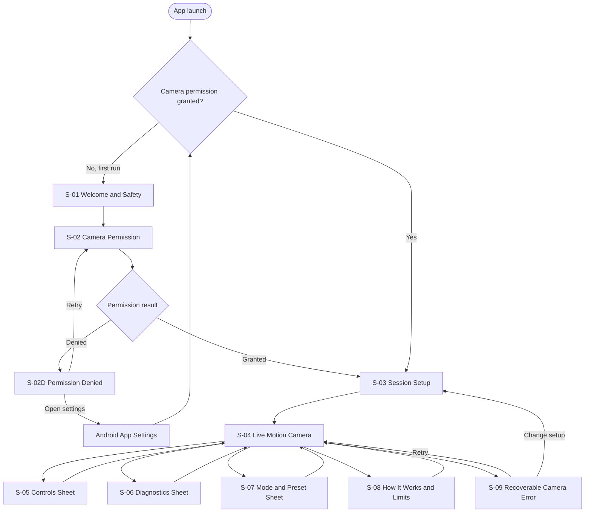

# MotionSight App Flow

## 1. Purpose

This document is the canonical screen and interaction map for the MotionSight R&D prototype. Screen designers should use the screen IDs and state names below when providing designs. Product requirements are in [prd.md](prd.md), and implementation boundaries are in [architecture.md](architecture.md).

## 1.1 Canonical visual reference

`S-04 Live Motion Camera` must be based on Figma node `1:2` in the [MotionSight design file](https://www.figma.com/design/2i1RDquvk1Qjwts2bZuNbg/MotionSight?node-id=1-2).

The reference establishes the visual system for every remaining screen:

- Near-black application background.
- Monochrome, high-contrast imagery and controls.
- Muted gray, uppercase Motion Sight wordmark.
- Large radii and generous negative space.
- Minimal persistent UI.
- Floating, fully rounded control capsules with a restrained glass treatment.
- Simple outline icons and quiet borders rather than decorative color.

Welcome, permission, setup, sheets, diagnostics, warnings, and errors should feel like states of this same camera instrument. They must not introduce an unrelated bright Material theme, colorful cards, gradients, or dense dashboard styling.

## 2. Navigation Model

MotionSight is a shallow, task-focused application with one primary destination: the live motion camera.



## 3. Global Flow Rules

- The app does not include sign-in, storage, capture, gallery, share, upload, or cloud flows.
- System Back closes a sheet before leaving the live camera.
- Leaving the live camera for setup releases or pauses camera resources as required by lifecycle ownership.
- Returning from background always resets temporal state and shows the preparing state.
- Rotation, zoom changes, mode changes, preset changes, lens changes, large scene changes, and manual background reset clear the old motion mask and trigger preparation.
- A rejected or unstable frame must not be presented as a valid near-full-screen motion event.
- White regions in the preview must always be described as detected motion, never as confirmed insects.

## 4. Primary Happy Path

### First launch

```text
S-01 Welcome and Safety
  -> S-02 Camera Permission
  -> Android permission prompt
  -> S-03 Session Setup
  -> select Fixed + Crawling
  -> Start
  -> S-04A Preparing Camera
  -> S-04B Active Detection
```

### Returning launch

```text
Launch
  -> S-03 Session Setup with last selections restored
  -> Start
  -> S-04A Preparing Camera
  -> S-04B Active Detection
```

The returning flow intentionally retains a setup checkpoint so the user confirms the physical capture condition before analysis begins.

## 5. Screen Inventory

| ID | Screen / surface | Purpose | Type |
|---|---|---|---|
| S-01 | Welcome and Safety | Set correct expectations and explain privacy | Full screen |
| S-02 | Camera Permission | Request camera access in context | Full screen + system prompt |
| S-02D | Permission Denied | Recover from denied or permanently denied permission | Full screen |
| S-03 | Session Setup | Select capture mode and target preset | Full screen |
| S-04 | Live Motion Camera | Run and observe motion detection | Full screen |
| S-05 | Controls | Tune detection and camera controls | Bottom sheet / side sheet in landscape |
| S-06 | Diagnostics | Inspect performance and confidence | Bottom sheet / overlay |
| S-07 | Mode and Preset | Change profile during a session | Compact sheet or dialog |
| S-08 | How It Works and Limits | Explain interpretation and operating guidance | Full-height sheet |
| S-09 | Camera Error | Recover from unavailable or failed camera | Full screen or blocking state |

## 6. Detailed Screen Specifications

### S-01 — Welcome and Safety

**Goal:** Establish what MotionSight does before showing the camera.

**Required content:**

- Product name and concise value proposition: make movement easier to see.
- A simple visual or diagram showing dim grayscale background plus white moving region.
- Clear statement: white indicates motion, not a confirmed insect.
- Clear statement: stationary insects will not be highlighted.
- Privacy statement: processing stays on the device; photos and video are not saved.
- Primary action: **Continue**.
- Secondary action: **How it works** may expand explanatory content but must not block progress.

**Transitions:**

- Continue → S-02.
- System Back → exit app.

**Design notes:**

- Avoid species imagery or “AI identification” language that could create a false promise.
- The limitations must be readable without opening legal-style fine print.

### S-02 — Camera Permission

**Goal:** Obtain the only runtime permission required by the prototype.

**Required content:**

- Camera icon or simple camera illustration.
- Explanation that live frames are required for on-device motion analysis.
- Reassurance that the app does not record or upload frames.
- Primary action: **Allow camera access**.
- Secondary action: **Not now**.

**Behavior:**

1. User taps Allow camera access.
2. Show Android's camera permission prompt.
3. Grant → S-03.
4. Denial → S-02D.

**Transitions:**

- Not now → S-02D.
- System Back → S-01 on first run.

### S-02D — Permission Denied

**Goal:** Explain why the app cannot proceed and provide recovery.

**Variants:**

- **D1 — Can ask again:** Primary action **Try again** opens the permission flow.
- **D2 — Permanently denied:** Primary action **Open app settings** opens Android settings.

**Required content:**

- Clear title: **Camera access is required**.
- Explanation that motion analysis cannot work without a live camera view.
- Primary recovery action based on variant.
- Secondary action: **Exit** or return to welcome.

**Transitions:**

- Permission becomes granted → S-03.
- Settings return without permission → remain on S-02D and re-evaluate on resume.

### S-03 — Session Setup

**Goal:** Configure the physical capture condition and target behavior before starting.

**Required controls:**

1. **How will you hold the camera?**
   - Fixed — recommended; phone stays still or is mounted.
   - Handheld — experimental; move slowly and smoothly.
2. **What movement are you looking for?**
   - Crawling — slower movement with longer persistence.
   - Flying — brief, small movement; works best in bright light.
3. Primary action: **Start motion view**.
4. Secondary information action: **Tips and limitations** → S-08.

**Default behavior:**

- First session defaults to Fixed + Crawling.
- Later sessions restore the last selected combination.
- One option in each group must be selected before Start is enabled.

**Profile-specific guidance:**

| Combination | Setup guidance |
|---|---|
| Fixed + Crawling | Mount or brace the phone; use a plain background when possible. |
| Fixed + Flying | Use bright light, keep the background uncluttered, and frame a small observation area. |
| Handheld + Crawling | Move slowly; expect reduced sensitivity and instability warnings. |
| Handheld + Flying | Most experimental; use bright light and very smooth movement. |

**Transitions:**

- Start motion view → S-04A.
- Tips and limitations → S-08, returning to S-03.
- System Back → exit app on returning flow, or prior permission/welcome surface when still in first-run flow.

### S-04 — Live Motion Camera

**Goal:** Make movement visible while keeping essential controls and system confidence understandable.

**Persistent layout regions:**

- Near-black edge-to-edge application background.
- Centered, muted uppercase **MOTION SIGHT** wordmark above the preview.
- Large, rounded-rectangle camera viewport with narrow side margins.
- Camera content rendered in dim grayscale with accepted motion pixels in white.
- Bottom-centered floating mode capsule over the preview:
  - Hand icon selects `MotionMode.HANDHELD`.
  - Tripod icon selects `MotionMode.FIXED`.
  - A dark selection indicator clearly marks the active option.
- A minimal contextual status or warning area that does not permanently compete with the wordmark.
- Secondary controls and metrics reached through S-05 and S-06 rather than a persistent toolbar.
- Target preset remains accessible through S-07 without adding a second large permanent switch to the reference composition.

**Interaction allocation:**

| Interaction | Recommended entry from S-04 |
|---|---|
| Switch Fixed/Handheld | Tap the floating Handheld/Tripod capsule |
| Open essential controls | Tap or swipe up from the capsule/preview's lower control region, with an explicit accessible action |
| Open diagnostics | Compact optional metric/status trigger or overflow action; do not permanently show a dense metric row |
| Change Crawling/Flying preset | S-07 profile action in the contextual/overflow surface |
| Open How It Works | Contextual/overflow information action |
| Show warnings | Temporary banner or overlay anchored within safe bounds, never hidden only inside a sheet |

**Do not include:** shutter button, record button, gallery thumbnail, species label, confidence that implies insect classification, or save/share actions.

**Reference fidelity requirements:**

- Preserve the main hierarchy: system bar → wordmark → dominant rounded preview → floating two-option capsule.
- Preserve the intentionally quiet top area and substantial negative space.
- Do not convert the mode capsule into a labeled segmented control on the primary screen; accessible labels may be announced and may appear contextually on long press, tooltip, or selection feedback.
- Do not copy the reference's absolute pixel positions. Adapt proportionally to Pixel 7 safe areas, Compose window insets, orientation, and font scaling.
- Use the exact exported icon/image assets when implementation begins, or approved Android equivalents only when their glyphs demonstrably match.

#### S-04A — Preparing Camera

**When shown:** Initial bind, app resume, rotation, zoom change, profile change, manual reset, resolution fallback, or large scene transition.

**UI behavior:**

- Preview may remain visible in grayscale.
- Clear the prior motion mask.
- Show **Preparing motion detection… Keep the camera still**.
- Controls that would invalidate initialization may remain available, but repeated action restarts preparation.
- Do not show zero motion as if it is a valid analyzed result.

**Exit condition:** Engine reaches its initialization threshold → S-04B.

#### S-04B — Active Detection

**When shown:** Camera and motion engine are ready and the current frame is accepted.

**UI behavior:**

- Show aligned white motion regions.
- Show current motion percentage.
- Essential controls remain available.
- Optional subtle label: **Motion view — not insect identification**.

#### S-04C — Camera Unstable

**When shown:** Handheld stabilization confidence is below threshold, movement is too rapid, parallax is excessive, or alignment fails.

**UI behavior:**

- Suppress or clear the rejected motion mask.
- Display a high-visibility warning that does not rely only on color.
- Guidance: **Move more slowly and keep the scene steady**.
- Optional confidence/status indicator in diagnostics.
- Do not leave most of the screen white.

**Exit condition:** Confidence recovers for the configured number of frames → S-04B.

#### S-04D — Performance Degraded

**When shown:** Processing repeatedly exceeds budget or the app has switched to fallback analysis resolution.

**UI behavior:**

- Preserve the responsive preview.
- Show a concise non-blocking status, such as **Reduced analysis resolution**.
- Expose detail in S-06, including actual resolution and processing time.
- If CameraX rebinds, temporarily transition through S-04A.

#### S-04E — Broad Scene or Light Change

**When shown:** A large scene transition or exposure flash invalidates the current temporal comparison.

**UI behavior:**

- Reject the misleading mask.
- Show a short **Scene changed — resetting** status.
- Move immediately to S-04A.

**Live-view actions and outcomes:**

| Action | Outcome |
|---|---|
| Background reset | Clear mask and temporal state → S-04A |
| Toggle torch | Apply if supported; reset if the illumination change invalidates state → S-04A |
| Change zoom | Apply zoom, clear state → S-04A |
| Open Controls | S-05 over S-04 |
| Open Diagnostics | S-06 over S-04 |
| Tap profile chip | S-07 over S-04 |
| Tap Handheld icon | Switch to Handheld, clear temporal state → S-04A |
| Tap Tripod icon | Switch to Fixed, clear temporal state → S-04A |
| Open information | S-08 over S-04 |
| App backgrounds | Pause/unbind as required; no background analysis |
| App resumes | Rebind/reset → S-04A |
| Fatal camera error | S-09 |
| System Back | Return to S-03 after confirmation only if accidental exits during tests are a problem; otherwise return directly |

### S-05 — Controls Sheet

**Goal:** Tune the camera and motion engine without leaving the session.

**Essential section:**

- Sensitivity slider with low/high meaning.
- Minimum object size slider with small/large meaning.
- Background reset action.
- Torch control and unavailable state.
- Zoom slider/value within supported range.

**Advanced section, collapsed by default:**

- Persistence.
- Background learning rate.
- Instability threshold; relevant primarily to Handheld mode.
- Restore active preset defaults.

**Behavior:**

- Changes that can safely apply live update subsequent frames.
- Settings that invalidate temporal history trigger a visible reset after the change is committed.
- Show human-readable values first; exact numeric values may appear as secondary R&D labels.
- Advanced changes are scoped to the active mode/preset combination.

**Transitions:**

- Swipe down, Close, or Back → S-04.
- Restore defaults → confirmation only if testers could lose meaningful tuning; then reset and return/remain.

### S-06 — Diagnostics Sheet

**Goal:** Provide evidence about current processing behavior without dominating the observer experience.

**Summary metrics:**

- Analysis FPS.
- Processing time in milliseconds.
- Actual analysis resolution.
- Motion percentage.

**Expanded R&D metrics:**

- Rolling median and p95 processing time.
- Accepted-result FPS and dropped/skipped frame estimate.
- Stabilization confidence and rejected-frame count in Handheld mode.
- Active mode and preset.
- Resolved setting values.
- Resolution fallback state.
- Thermal/degraded status if available.
- Session generation or reset count for debugging builds only.

**States:**

- A metric that is not supported or not yet available displays **—**, not a misleading zero.
- Stabilization metrics are marked not applicable in Fixed mode.

**Transitions:** Close or Back → S-04.

### S-07 — Mode and Preset Sheet

**Goal:** Change the active profile during a session.

**Required content:**

- Fixed / Handheld segmented selection.
- Crawling / Flying segmented selection.
- Short guidance that updates with the selected combination.
- Primary action: **Apply**.
- Secondary action: **Cancel**.

**Behavior:**

- Selection changes are staged until Apply.
- Apply resolves preset settings, clears temporal state, closes the sheet, and enters S-04A.
- If the active profile has unsaved advanced tuning, the product should either preserve it per profile or clearly warn before replacing it. The chosen behavior must remain consistent.

### S-08 — How It Works and Limits

**Goal:** Help users operate the prototype correctly and interpret results conservatively.

**Required sections:**

- **What you see:** white means detected movement; gray is the live scene.
- **What it cannot do:** identify insects, detect motionless insects, or reliably distinguish targets from dust, shadows, leaves, people, or flicker.
- **Best results:** fixed phone, close subject, appropriate zoom, strong lighting, plain background.
- **Handheld mode:** experimental; move slowly and expect lower sensitivity.
- **Privacy:** on-device processing; no image or video saving.

**Entry/return behavior:**

- Opened from setup → close returns to S-03.
- Opened from live view → close returns to S-04 without resetting the session unless lifecycle behavior required a pause.

### S-09 — Recoverable Camera Error

**Goal:** Recover when a camera session cannot start or continue.

**Variants:**

- Camera unavailable or in use by another application.
- Camera binding failed.
- Vision engine failed to initialize.
- Rendering failed to recover.

**Required content:**

- Plain-language problem statement.
- Primary action: **Try again**.
- Secondary action: **Change setup**.
- Optional compact technical detail available to R&D testers.

**Transitions:**

- Try again → camera bind → S-04A on success; remain on S-09 on failure.
- Change setup → S-03.

## 7. Flow by Detection Profile

### Fixed + Crawling

```text
S-03 select Fixed + Crawling
  -> S-04A learn background
  -> S-04B highlight persistent slow motion
  -> optional S-05 tune sensitivity/minimum size
  -> background or framing changes
  -> Reset
  -> S-04A
```

### Fixed + Flying

```text
S-03 select Fixed + Flying
  -> show bright-light guidance
  -> S-04A learn background
  -> S-04B highlight brief smaller motion
  -> optional torch/zoom adjustment
  -> S-04A after invalidating adjustment
```

### Handheld + Crawling

```text
S-03 select Handheld + Crawling
  -> experimental guidance
  -> S-04A initialize tracking
  -> S-04B accepted stabilized residual motion
  -> excessive movement
  -> S-04C Camera Unstable
  -> smooth movement resumes
  -> S-04B
```

### Handheld + Flying

```text
S-03 select Handheld + Flying
  -> strongest experimental warning + bright-light guidance
  -> S-04A initialize tracking
  -> S-04B accepted brief residual motion
  -> S-04C whenever alignment confidence is inadequate
```

## 8. System and Interruption Flows

### Background and resume

```text
S-04 active
  -> app moves to background
  -> stop analysis and release/pause camera resources
  -> app resumes
  -> re-check permission and camera availability
  -> S-04A
  -> S-04B or S-09
```

### Rotation

```text
S-04 active
  -> device orientation changes
  -> preserve chosen profile and tunable settings
  -> recompute preview/mask transforms
  -> clear temporal state
  -> S-04A
```

### Permission revoked outside the app

```text
App resumes
  -> permission check fails
  -> S-02D permanently denied variant
  -> Open app settings
  -> permission granted
  -> S-03
```

### Resolution fallback

```text
S-04B sustained processing above budget
  -> S-04D degraded status
  -> controlled analysis rebind at fallback request
  -> inspect actual selected resolution
  -> S-04A
  -> S-04B with reduced-resolution diagnostic
```

## 9. Component and State Checklist for Screen Delivery

When providing designs, include the following frames or component states.

### Required full-screen designs

- S-01 Welcome and Safety.
- S-02 Camera Permission.
- S-02D Permission Denied: retry variant and settings variant.
- S-03 Session Setup with all four selection combinations represented or specified.
- S-04 Live Motion Camera in portrait, using Figma node `1:2` as the direct visual source.
- S-04 Live Motion Camera in landscape or a clear responsive-layout specification.
- S-08 How It Works and Limits.
- S-09 Camera Error.

### Required live-camera states

- S-04A Preparing.
- S-04B Active with a small accepted mask.
- S-04B Active with a larger but valid mask.
- S-04C Camera Unstable.
- S-04D Performance Degraded / reduced resolution.
- S-04E Scene changed / resetting.
- Torch unavailable.
- Zoom adjustment and subsequent reset.
- Diagnostics collapsed and expanded.

### Required sheets

- S-05 Controls, essential state.
- S-05 Controls, advanced expanded state.
- S-06 Diagnostics for Fixed mode.
- S-06 Diagnostics for Handheld mode with confidence.
- S-07 Mode and Preset change.

### Component states

- Default, pressed, focused, disabled, and unavailable controls.
- Selected/unselected mode and preset options.
- Slider minimum, intermediate, and maximum.
- Warning banner, informational banner, and blocking error.
- Values unavailable (`—`) versus valid zero.
- Large font/accessibility behavior.
- Floating Handheld/Tripod capsule with each option selected, pressed, focused, and disabled where applicable.
- Main preview with no motion, sparse motion, and dense-but-accepted motion while preserving the reference composition.

## 9.1 Visual inheritance checklist

Every new screen supplied for the project should answer yes to the following:

- Does it use the same near-black canvas and restrained grayscale palette as the main screen?
- Does it preserve generous spacing instead of filling the screen with containers?
- Are large rounded surfaces and pill controls used consistently and selectively?
- Are headings quiet and typographically related to the Motion Sight wordmark?
- Are icons simple, monochrome, and visually consistent with the Handheld/Tripod pair?
- Are sheets and dialogs dark, minimally bordered, and subordinate to the camera content?
- Are functional warnings legible without introducing a permanent competing accent color?
- Does the screen avoid implying recording or insect identification?

## 10. Screen Copy Principles

- Say **motion**, **moving area**, or **highlighted movement**.
- Do not say **insect detected**, **bug found**, **identified**, or show species certainty.
- Prefer **Camera unstable** over technical terms such as failed homography.
- Prefer **Preparing motion detection** over initializing MOG2.
- Pair warnings with a corrective action: hold still, move slowly, add light, move closer, reset, or retry.
- Keep experimental status visible for Handheld mode without making every frame feel like an error.

## 11. Accessibility and Ergonomics

- All controls require accessible names, roles, and state announcements.
- Warnings use iconography and text in addition to color.
- Controls over the camera image need sufficient contrast across light and dark scenes.
- Touch targets should be at least 48 × 48 dp.
- Bottom controls must remain reachable on a Pixel 7 in portrait.
- Sheets must support large text and scrolling without hiding the primary action.
- Motion-percentage updates should not be announced continuously by screen readers; expose the latest value on focus instead.
- Respect system animation preferences for nonessential transitions.

## 12. Acceptance Scenarios

### AF-01 — First successful session

Given a first-time user has not granted permission, when they complete education, grant camera access, choose Fixed + Crawling, and start, then the app shows preparation followed by a responsive grayscale camera view with accepted motion rendered white.

### AF-02 — Permission recovery

Given camera permission was permanently denied, when the user opens system settings, grants access, and returns, then the app proceeds to session setup without requesting unrelated permissions.

### AF-03 — Manual background reset

Given detection is active, when the user resets the background, then the previous white mask disappears immediately, the app shows preparation, and valid motion rendering resumes only after initialization.

### AF-04 — Handheld instability

Given Handheld mode is active, when alignment confidence falls below threshold, then the frame is rejected, the preview does not become mostly white, and the app tells the user to move more slowly and keep the scene steady.

### AF-05 — Zoom invalidates history

Given detection is active, when zoom changes, then preview and mask alignment remain correct, temporal history resets, and the app returns through the preparing state.

### AF-06 — Processing fallback

Given processing repeatedly exceeds the frame budget, when the performance governor triggers fallback, then the camera is safely rebound if required, temporal state resets, the actual selected resolution is displayed, and the preview remains responsive.

### AF-07 — Resume privacy and lifecycle

Given an active session moves to the background, then analysis does not continue as a hidden monitoring service; when the app returns, the camera and temporal state are safely reinitialized.

### AF-08 — Claims remain calibrated

Given any accepted white motion region, then no screen labels it as an insect or assigns a species or insect-confidence score.
