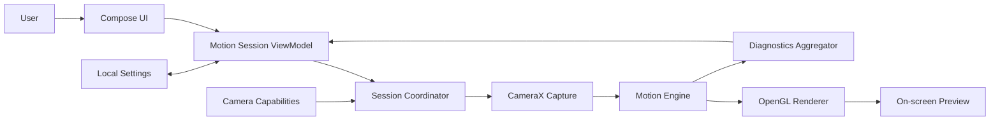
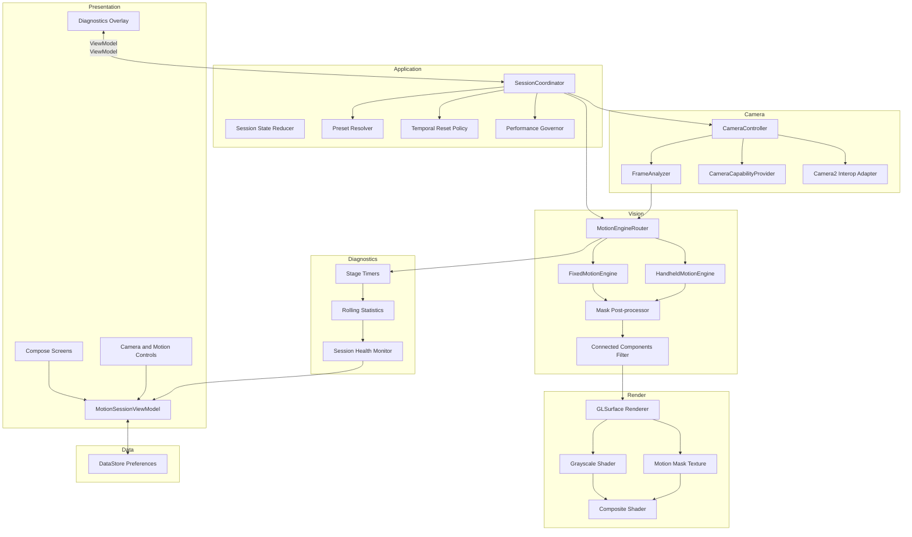
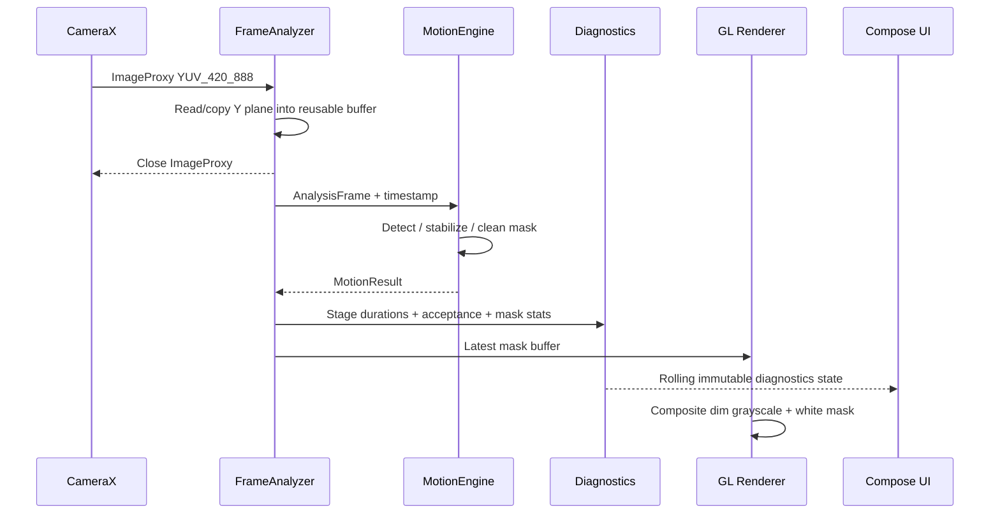
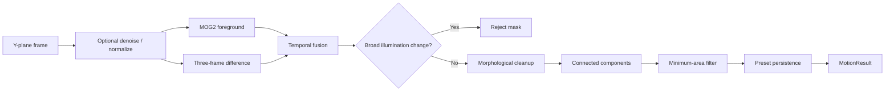
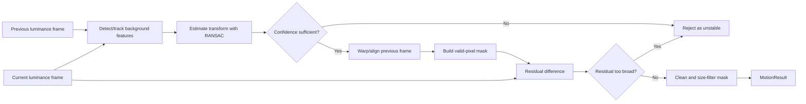
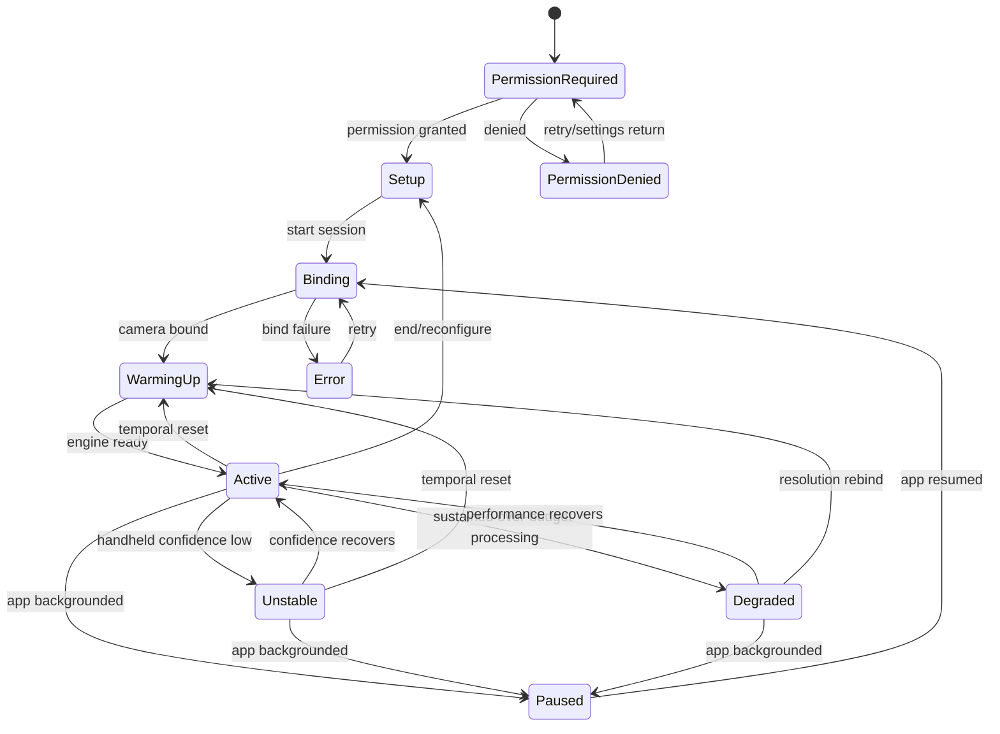

# MotionSight Technical Architecture

## 1. Purpose

This document defines the technical architecture for the MotionSight Android R&D prototype described in [prd.md](prd.md). The architecture prioritizes real-time responsiveness, deterministic cleanup, testability, and the ability to add an insect-classification stage later without rewriting camera capture or motion detection.

## 2. Technology Baseline

| Area | Choice |
|---|---|
| Language | Kotlin |
| UI | Jetpack Compose |
| Camera | CameraX 1.6.1 with limited Camera2 interop where required |
| Computer vision | OpenCV 4.14 |
| Rendering | OpenGL ES |
| Concurrency | Kotlin coroutines plus dedicated analysis/render execution contexts |
| Minimum platform | Android 8.0 / API 26 |
| Primary device | Pixel 7, rear main camera |
| Target analysis | Requested 1280 × 720 at 30 FPS; fallback request 960 × 540 |
| Frame format | `YUV_420_888`, luminance/Y plane for analysis |
| Backpressure | `ImageAnalysis.STRATEGY_KEEP_ONLY_LATEST` |
| Dependency injection | Lightweight constructor injection; a DI framework is optional, not required for the prototype |

Library versions must be pinned in the version catalog. Native OpenCV packaging and supported ABIs must be documented in the build configuration.

### Design reference

The implementation target for the main camera surface is Figma node `1:2` in [MotionSight](https://www.figma.com/design/2i1RDquvk1Qjwts2bZuNbg/MotionSight?node-id=1-2). Design measurements in that frame appear to use a 1080 × 2400 Pixel-style canvas. They must be converted into density-independent Compose dimensions and responsive constraints; raw Figma pixel values must not be copied directly as Android `dp` values.

## 3. Architectural Principles

1. **Camera frames have one owner.** Every `ImageProxy` is closed exactly once, even after cancellation or failure.
2. **Latest data wins.** The system drops obsolete analysis work rather than building latency.
3. **CPU analyzes; GPU presents.** Luminance-based computer vision runs off the UI thread; OpenGL composites preview and mask.
4. **Temporal state is explicit.** Detection state has a lifecycle and is reset after any scene or camera change that invalidates it.
5. **Algorithms are replaceable.** Fixed and handheld engines share a stable contract and can be benchmarked independently.
6. **UI consumes state, not camera objects.** Compose observes immutable session state and issues intents through a ViewModel.
7. **Metrics are first-class outputs.** Timing, resolution, motion percentage, and confidence travel with each result.
8. **Privacy is structural.** No storage or networking component receives frames.

## 4. System Context



There is deliberately no media repository, upload client, account service, or cloud API in Version 1.

## 5. Component Architecture



## 6. Module Boundaries

A single application module is acceptable for the first spike, but the source packages must preserve these boundaries. If the prototype proceeds beyond feasibility, split them into Gradle modules without changing public contracts.

| Logical module | Responsibility | Must not own |
|---|---|---|
| `app` / presentation | Compose screens, navigation, permission UI, accessibility | OpenCV algorithms or raw `ImageProxy` lifecycle |
| `session` | Session orchestration, state machine, resets, mode changes | Pixel operations or GL implementation |
| `camera` | CameraX binding, capabilities, torch, zoom, frame delivery | Detection policy or UI state rendering |
| `motion-api` | Shared models and `MotionEngine` contract | CameraX or Compose types |
| `motion-fixed` | Background subtraction and frame-difference pipeline | Handheld stabilization |
| `motion-handheld` | Feature tracking, RANSAC alignment, residual motion | UI warning presentation |
| `render` | Grayscale camera presentation and white-mask compositing | Detection decisions |
| `diagnostics` | Rolling performance and stability metrics | Camera frame persistence |
| `settings` | Preset defaults and local preferences | Images, masks, or session recordings |

## 7. Domain Contracts

```kotlin
enum class MotionMode { FIXED, HANDHELD }

enum class TargetPreset { CRAWLING, FLYING }

data class MotionSettings(
    val sensitivity: Float,
    val minimumAreaPx: Int,
    val persistenceFrames: Int,
    val learningRate: Double,
    val instabilityThreshold: Float,
)

data class AnalysisFrame(
    val luminance: ByteBuffer,
    val width: Int,
    val height: Int,
    val rowStride: Int,
    val rotationDegrees: Int,
    val timestampNanos: Long,
)

data class MotionResult(
    val mask: MotionMask,
    val processingDurationNanos: Long,
    val motionPercentage: Float,
    val stabilizationConfidence: Float?,
    val acceptance: FrameAcceptance,
)

enum class FrameAcceptance {
    ACCEPTED,
    WARMING_UP,
    REJECTED_UNSTABLE,
    REJECTED_SCENE_CHANGE,
    REJECTED_EXPOSURE_FLASH,
}

interface MotionEngine {
    fun configure(settings: MotionSettings)
    fun process(frame: AnalysisFrame): MotionResult
    fun reset(reason: ResetReason)
    fun release()
}
```

Implementation note: a zero-copy or reusable-buffer representation may replace the illustrative `ByteBuffer`/`MotionMask` types, but camera-specific classes must not leak into the engine API.

## 8. Runtime Data Flow



Rules:

- The analyzer closes the `ImageProxy` in a `finally` block.
- Only the newest pending frame may wait for processing.
- Temporal processing for a session is serialized; frames must not mutate one engine concurrently.
- Camera buffer data is copied or consumed before `ImageProxy.close()` unless a proven safe ownership mechanism is used.
- Render and UI updates are decoupled from the analyzer so a slow UI recomposition cannot block frame processing.
- Buffers, OpenCV `Mat` objects, and mask textures are reused after initialization.

## 9. Motion Pipelines

### 9.1 Fixed engine



Key behavior:

- Warm-up frames seed the background model and produce `WARMING_UP` rather than valid detection.
- MOG2 supports adaptive foreground detection.
- Three-frame differencing preserves slow or recently moving targets that may otherwise be absorbed too quickly.
- Exposure-flash suppression considers the changed-pixel ratio and global luminance shift.
- Learning rate and persistence come from the active resolved preset.

### 9.2 Handheld engine



The first implementation should benchmark sparse Lucas–Kanade optical flow plus an affine or homography estimate. The transform choice must be based on measured accuracy and cost; homography should not be assumed superior in scenes with strong parallax.

## 10. Rendering Architecture

The output consists of two synchronized visual inputs:

1. The current camera image, sampled and converted to grayscale.
2. The most recent accepted motion mask, uploaded as a single-channel texture.

Conceptual fragment behavior:

```text
gray = luminance(cameraPixel) * dimFactor
output = maskPixel >= threshold ? white : gray
```

Requirements:

- Scale and rotate the mask using the same crop, transform, and orientation as the camera image.
- Timestamp or generation-tag masks so a stale result can be cleared after resets.
- Clear the mask for rejected frames rather than reusing a misleading detection indefinitely.
- Keep warning banners and controls in Compose above the GL surface; do not bake UI into the shader.
- Validate mask/preview alignment in portrait, landscape, zoomed, and fallback-resolution states.

### 10.1 Main-screen composition contract

The Compose layer around the GL camera surface must preserve these properties from Figma node `1:2`:

- Edge-to-edge near-black application background (`#121212` in the reference).
- System status-bar content presented for a dark surface.
- Centered uppercase **MOTION SIGHT** wordmark using Poppins Regular or the project's packaged equivalent, in subdued gray (`#656565` in the reference).
- A dominant preview with very large rounded corners and narrow horizontal margins.
- A floating bottom-centered control capsule over the preview, using a translucent light surface, subtle light border, backdrop/glass intent, and fully rounded geometry.
- Two icon-only capture-mode options: Handheld and Tripod. Tripod is the UI label for the domain value `MotionMode.FIXED`; Handheld maps to `MotionMode.HANDHELD`.
- A dark circular/rounded selection indicator that moves between the two mode options.
- No shutter, record, gallery, or media-saving affordance.

The Figma frame contains raster and vector references whose generated download URLs are temporary. During implementation, assets must be re-exported from the source node and committed as Android resources where licensing and format permit. Do not depend on temporary Figma asset URLs at runtime.

Compose owns the wordmark, capsule, state indicators, warning banners, sheets, and accessibility semantics. OpenGL owns only the grayscale preview and aligned white motion mask inside the rounded preview viewport. The rounded shape must clip both camera and mask identically.

Because the reference intentionally keeps the main screen sparse, sensitivity, minimum-area, torch, zoom, reset, and expanded diagnostics belong in sheets or contextual overlays defined in `appflow.md`. They must not be permanently added as a dense toolbar around the preview.

## 11. Session State Machine



The application exposes one immutable `MotionSessionUiState` derived from this machine. Transient UI events such as opening system settings are separate effects and must not be encoded as sticky state.

## 12. Temporal Reset Policy

The coordinator resets or reconstructs the engine after:

- Display rotation or analysis orientation change.
- Capture mode or target preset change.
- Camera/lens change.
- Zoom change.
- App pause/resume.
- Analysis-resolution fallback or camera rebind.
- Large scene transition.
- User-requested background reset.

Reset behavior:

1. Stop publishing previous masks.
2. Increment a session generation identifier.
3. Clear engine temporal buffers and tracking history.
4. Enter `WarmingUp`.
5. Resume accepted masks only after initialization criteria are met.

Late results from an older generation are discarded.

## 13. Performance Governor

The frame budget at 30 FPS is approximately 33.3 ms. Performance decisions must use rolling statistics rather than one slow frame.

Suggested policy for calibration:

- Maintain rolling median, p95, accepted FPS, and consecutive/ratio-over-budget measures.
- Enter a warning/degraded state when processing repeatedly exceeds the budget.
- Request 960 × 540 through a controlled CameraX rebind when the over-budget threshold is sustained.
- Apply hysteresis; do not oscillate resolutions during one session.
- For Version 1, remain at the fallback resolution until a new session unless testing demonstrates stable automatic recovery.
- Record the actual resolution returned by CameraX after every bind.

Exact windows and thresholds are configuration values finalized through Pixel 7 profiling.

## 14. Concurrency and Resource Management

- Bind and unbind CameraX according to the visible lifecycle.
- Run frame analysis on a dedicated single-consumer execution context.
- Run OpenGL on its renderer thread.
- Marshal only small immutable state to the main thread.
- Do not allocate a new large bitmap, `Mat`, or byte array per frame.
- Release OpenCV native objects, textures, surfaces, and executors deterministically.
- Cancel outstanding work on session generation change; discard results that cannot be safely canceled.
- Avoid a general unbounded coroutine scope or queue.
- Use strict-mode and memory profiling during development to identify main-thread work and leaks.

## 15. Camera Control and Capability Handling

`CameraCapabilityProvider` resolves at runtime:

- Available rear cameras and the main-camera selection.
- Actual analysis resolution and frame-rate behavior.
- Torch availability and current state.
- Supported linear zoom range.
- Exposure-time or exposure-compensation support.
- Camera2 interop availability for flying-preset experiments.

Unsupported controls remain visible only when the explanation is useful; otherwise they are omitted. Any experimental exposure control must be feature-gated and fall back to normal auto-exposure without preventing the session.

## 16. Settings and Persistence

Use DataStore only for small non-sensitive preferences:

- Last capture mode and target preset.
- User-adjusted motion settings by profile, if product testing benefits from persistence.
- Diagnostics expanded/collapsed preference.
- First-run education completion.

Do not persist frames, masks, feature points, background models, or camera-derived thumbnails. Temporal models exist only in memory for the active session.

## 17. Error Handling

| Failure | System response | User response |
|---|---|---|
| Camera permission denied | Do not bind camera | Explain and offer retry/settings |
| Camera unavailable/bind failure | Release partial resources; allow retry | Full-screen recoverable error |
| Analyzer exception | Close frame; reset engine if needed; keep session supervised | Non-blocking error or retry state based on severity |
| OpenCV initialization failure | Disable session startup | Blocking error with diagnostic detail in R&D build |
| GL context loss | Recreate textures/shaders and clear stale mask | Brief preparing state |
| Stabilization failure | Reject frame/mask | “Camera unstable” guidance |
| Resolution fallback | Rebind safely and reset temporal state | Degraded-resolution diagnostic |
| Unsupported torch/exposure | Disable capability | Contextual unavailable state |
| Thermal pressure | Reduce optional work or warn; preserve cleanup | Performance/temperature warning in diagnostics |

## 18. Testing Strategy

### 18.1 Unit tests

- Preset-to-settings resolution.
- Session state reducer and generation handling.
- Temporal reset policy.
- Performance-governor threshold and hysteresis logic.
- Motion-percentage and connected-component filtering calculations.
- Exposure-flash and instability classification using synthetic metrics.

### 18.2 Algorithm tests

- Store labeled test clips outside the shipped application and feed decoded luminance frames through engine test harnesses.
- Run every candidate engine against identical frame sequences.
- Verify deterministic metrics within documented native-library tolerances.
- Include empty scenes, global lighting changes, shadows, foliage, flicker, camera shake, parallax, and insects at different pixel sizes.

### 18.3 Instrumented/device tests

- Permission grant, denial, permanent denial, and settings return.
- Camera lifecycle across background/resume and rotation.
- Torch and zoom capability behavior.
- Preview/mask spatial alignment.
- Actual resolution reporting and fallback rebind.
- Ten-minute endurance, memory, dropped-frame, and thermal tests on Pixel 7.

### 18.4 UI tests

- Setup selections and four profile combinations.
- Preparing, active, unstable, degraded, and error states.
- Essential/advanced controls and restore-default behavior.
- Accessibility labels, focus order, large text, and orientation changes.

## 19. Observability for the R&D Build

The in-app diagnostics model should expose:

- Actual analysis width and height.
- Analysis FPS and accepted-result FPS.
- Per-stage and total processing time.
- Rolling median and p95 latency.
- Dropped/skipped frame estimate.
- Motion percentage.
- Stabilization confidence and rejected-frame count.
- Current mode, preset, resolved settings, and session generation.
- Resolution-fallback and thermal status.

Logs must contain metrics and state transitions only. Do not log pixel buffers, encoded images, masks, or other reconstructable camera content.

## 20. Future Extension: Insect Classification

If feasibility targets are met, add a consumer of detected regions after connected-component filtering:

```text
MotionEngine -> Region Proposals -> Tracker -> Insect Classifier -> Presentation
```

The future classifier should receive bounded region crops or derived features through a new explicit interface. It must not become a dependency of camera capture, stabilization, or base rendering. Privacy, model size, latency, false-claim language, and data collection would require a new PRD revision.

## 21. Recommended Source Layout

```text
app/src/main/java/.../motionsight/
  presentation/
    navigation/
    onboarding/
    setup/
    camera/
    information/
  session/
    MotionSessionViewModel.kt
    SessionCoordinator.kt
    SessionState.kt
    TemporalResetPolicy.kt
    PerformanceGovernor.kt
  camera/
    CameraController.kt
    CameraCapabilityProvider.kt
    FrameAnalyzer.kt
    Camera2InteropAdapter.kt
  motion/
    api/
    fixed/
    handheld/
    postprocess/
  render/
    MotionGlRenderer.kt
    TextureBridge.kt
  diagnostics/
  settings/
```

## 22. Architectural Decisions to Validate Early

1. Camera preview path compatible with the required OpenGL compositing and CameraX lifecycle.
2. Exact preview-to-analysis coordinate transform under crop, rotation, and zoom.
3. Whether Y-plane copying or a controlled native buffer bridge produces the best safe latency.
4. Sparse optical-flow transform type and feature count on Pixel 7.
5. CameraX fallback/rebind behavior and its visible interruption.
6. MOG2 learning-rate and temporal-fusion defaults for each profile.
7. Thermal behavior and allocation stability during the 10-minute endurance run.

These decisions are resolved through measured spikes, then recorded as architecture decision records if the project advances beyond the prototype.

## 23. References

- [CameraX ImageAnalysis](https://developer.android.com/media/camera/camerax/analyze)
- [CameraX ImageAnalysis.Builder](https://developer.android.com/reference/androidx/camera/core/ImageAnalysis.Builder)
- [OpenCV background subtraction](https://docs.opencv.org/5.0/tutorials/others/background_subtraction.html)
- [OpenCV optical flow](https://docs.opencv.org/4.x/d4/dee/tutorial_optical_flow.html)
